# Siaga Bencana
### Sistem Informasi Manajemen Posko Evakuasi

> Satu aplikasi untuk mengelola **posko, pengungsi, logistik, fasilitas, dan distribusi bantuan antar posko**, ditambah **halaman publik** agar warga bisa menemukan posko terdekat yang masih menerima pengungsi.

---

## Daftar Isi

1. Ringkasan singkat
2. Latar belakang & masalah
3. Solusi yang ditawarkan
4. Siapa penggunanya
5. Peta fitur (menu aplikasi)
6. Arsitektur & teknologi
7. Model data
8. **Alur bisnis proses** (inti presentasi)
9. Matriks hak akses
10. Keamanan & integritas data
11. Kualitas & pengujian
12. Skenario demo
13. Keterbatasan & rencana pengembangan
14. Antisipasi pertanyaan (Q&A)
15. Lampiran: kamus status

**Saran pembagian waktu (±20 menit):** latar belakang 2 menit, pengguna & fitur 3 menit, alur bisnis 8 menit, keamanan & kualitas 2 menit, demo 4 menit, penutup 1 menit.

---

## 1. Ringkasan Singkat

| Pertanyaan | Jawaban |
| --- | --- |
| **Apa ini?** | Aplikasi web untuk mengelola posko evakuasi bencana dan bantuan logistiknya. |
| **Untuk siapa?** | Petugas posko (internal, perlu login) dan warga umum (halaman publik, tanpa login). |
| **Masalah utama yang diselesaikan** | Data posko tersebar, stok bantuan tidak terpantau, distribusi antar posko tidak tercatat, dan warga tidak tahu harus mengungsi ke mana. |
| **Nilai utama** | Satu sumber data yang **real-time, tercatat, dan bisa diaudit**. Setiap barang keluar-masuk ada jejaknya. |
| **Contoh data** | 5 posko di wilayah Sidoarjo (Balai Desa Candi, GOR Sidoarjo, Kantor Kecamatan Taman, Balai RW Waru, Gedangan Lama). |

---

## 2. Latar Belakang & Masalah

Dalam situasi bencana (banjir, gempa, dan lain-lain), pengelolaan posko evakuasi sering menghadapi masalah berikut:

1. **Data pengungsi manual.** Posko tidak tahu pasti sudah berapa orang yang ditampung dan apakah masih muat.
2. **Stok bantuan tidak terpantau.** Ada posko yang kelebihan beras sementara posko lain kehabisan, dan tidak ada yang tahu.
3. **Distribusi antar posko tanpa jejak.** Barang dikirim tanpa persetujuan dan tanpa bukti terima, sehingga rawan selisih dan hilang.
4. **Fasilitas rusak tidak tertangani.** Toilet, tenda, atau genset yang rusak tidak tercatat siapa yang menangani dan kapan selesai.
5. **Warga bingung.** Warga tidak tahu posko mana yang terdekat dan masih menerima pengungsi.
6. **Pimpinan tidak punya gambaran utuh.** Laporan dibuat manual, terlambat, dan sulit diverifikasi.

---

## 3. Solusi yang Ditawarkan

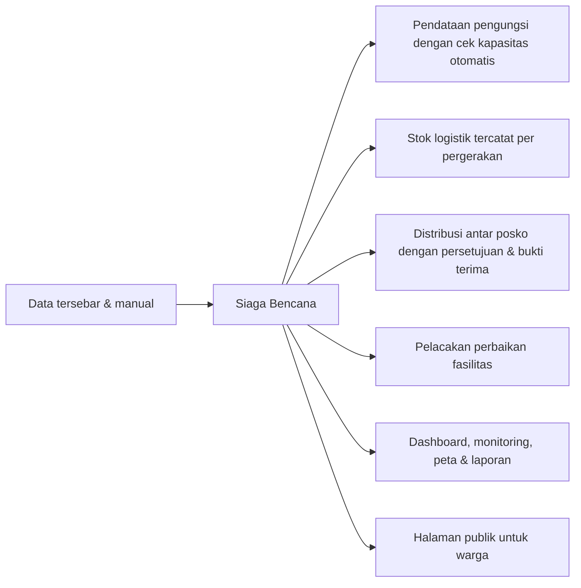

**Prinsip desain:**
- **Tidak ada angka yang diubah diam-diam.** Stok hanya berubah lewat transaksi yang tercatat (masuk, rusak, hilang, kirim, terima).
- **Setiap orang hanya melihat dan mengubah wilayah tugasnya** (posko dan divisinya sendiri).
- **Aturan bisnis dijaga oleh sistem, bukan oleh kehati-hatian petugas.** Contohnya: posko penuh tidak bisa menerima pendaftaran, dan stok tidak bisa minus.

---

## 4. Siapa Penggunanya

### 4.1 Pengguna publik (tanpa login)
Warga yang mencari posko, keluarga yang mencari informasi, dan relawan.

### 4.2 Pengguna internal (4 peran)

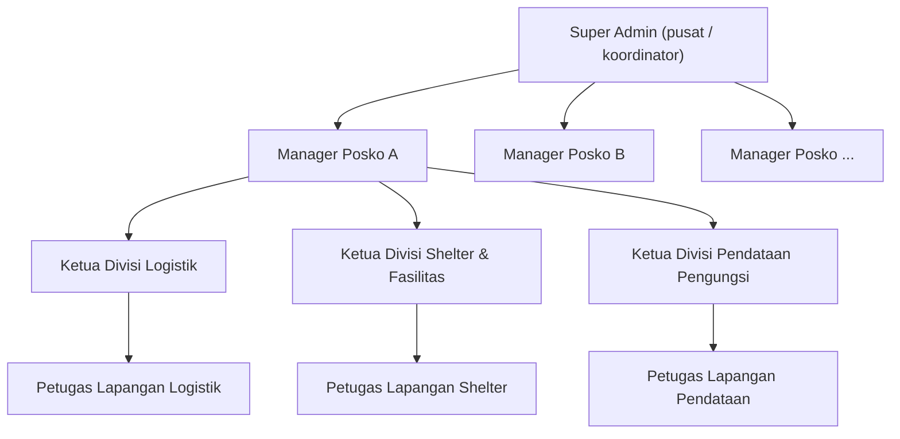

| Peran | Tanggung jawab | Cakupan data |
| --- | --- | --- |
| **Super Admin** | Membuat posko, menunjuk manager & ketua divisi, **menyetujui distribusi antar posko**, mengelola akun | Semua posko |
| **Manager Posko** | Memimpin satu posko, mengawasi semua divisi, mengajukan permintaan bantuan | 1 posko (1 manager per posko) |
| **Ketua Divisi** | Memimpin satu divisi di satu posko | 1 posko, 1 divisi (1 ketua per divisi per posko) |
| **Petugas Lapangan** | Menginput data harian sesuai divisinya | 1 posko, 1 divisi |

**3 divisi di setiap posko:**
- **Logistik:** stok barang dan distribusi.
- **Shelter & Fasilitas:** kondisi tenda, toilet, dapur umum, genset, dan sebagainya.
- **Pendataan Pengungsi:** registrasi masuk dan check-out pengungsi.

---

## 5. Peta Fitur (Menu Aplikasi)

| Kelompok | Menu | Fungsi singkat |
| --- | --- | --- |
| **Overview** | Dashboard | Ringkasan angka + **daftar tugas** yang perlu ditindaklanjuti |
| | Monitoring | Peringatan dini: posko hampir penuh, stok kritis, fasilitas rusak |
| | Peta Bencana | Peta semua posko dengan warna tingkat keterisian |
| **Operasional** | Kelola Posko | Membuat/mengubah/menutup posko (Super Admin), dilihat Manager |
| | Logistik | Stok barang per posko + riwayat pergerakan |
| | Shelter | Kondisi & perbaikan fasilitas |
| | Pengungsi | Registrasi & check-out pengungsi |
| | Distribusi | Permintaan & pengiriman barang antar posko |
| **Data & Informasi** | Laporan | Laporan periode, cetak PDF, kirim ke Google Sheets |
| | Riwayat Aktivitas | Jejak siapa melakukan apa dan kapan |
| **Administrasi** | Pengguna | Akun & struktur tim |
| | Pengaturan | Profil, ganti password, info sistem |
| **Publik** | `/public` | Info posko untuk warga, tanpa login |

---

## 6. Arsitektur & Teknologi

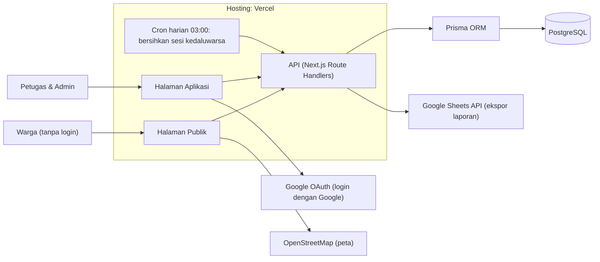

| Lapisan | Teknologi | Alasan pemilihan |
| --- | --- | --- |
| Frontend + Backend | **Next.js 16** (App Router), **React 19**, TypeScript | Satu codebase untuk tampilan dan API, cepat dikembangkan |
| Tampilan | Tailwind CSS 4 | Konsisten dan responsif (HP sampai desktop) |
| Database | **PostgreSQL** + **Prisma 7** | Transaksi kuat dan aturan data bisa dikunci di level database |
| Peta | Leaflet + OpenStreetMap | Gratis, tanpa API key |
| Login | Sesi cookie + bcrypt, opsional Google | Aman, sesi bisa dicabut kapan saja |
| Laporan | Google Sheets API | Pimpinan bisa langsung membuka di spreadsheet |
| Hosting | Vercel | Deploy otomatis setiap ada perubahan kode |
| Pengujian | Vitest (unit + integrasi dengan database sungguhan) | Menjamin aturan bisnis tidak rusak saat kode diubah |

---

## 7. Model Data (Disederhanakan)

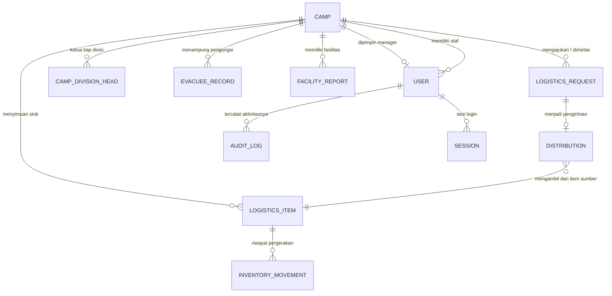

| Tabel | Isi |
| --- | --- |
| **Camp** (Posko) | Nama, alamat, koordinat, kapasitas maksimal, jumlah penghuni saat ini, status Aktif/Ditutup |
| **User** | Akun, peran, divisi, posko |
| **EvacueeRecord** (Pengungsi) | Nama, jumlah anggota keluarga, kebutuhan khusus, waktu datang & pulang |
| **LogisticsItem** (Barang) | Nama barang, jumlah, jumlah dicadangkan, jumlah rusak, batas minimum, satuan |
| **InventoryMovement** | **Buku besar stok**: setiap pergerakan barang (siapa, berapa, kenapa, kapan) |
| **LogisticsRequest** | Permintaan barang dari satu posko ke posko lain |
| **Distribution** | Pengiriman fisik hasil permintaan yang disetujui, termasuk foto bukti terima |
| **FacilityReport** | Fasilitas dan status kondisinya |
| **AuditLog** | Jejak semua aktivitas pengguna |

---

## 8. Alur Bisnis Proses

### 8.0 Gambaran Besar (Dari Awal Sampai Akhir)

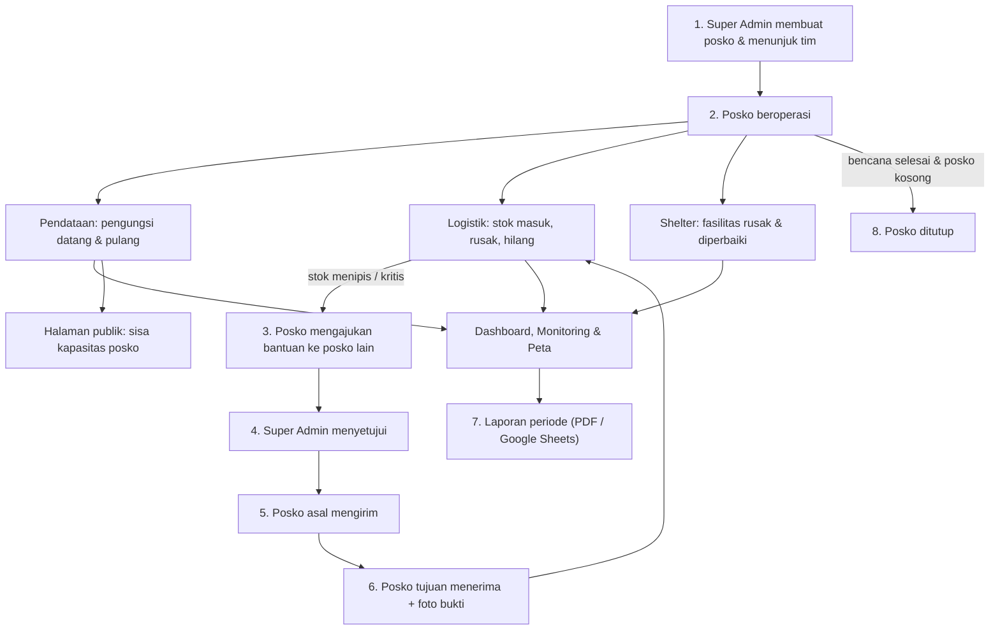

Ringkasnya: **siapkan posko, jalankan operasional harian, saling bantu antar posko, pantau, laporkan, lalu tutup posko.**

---

### 8.1 Siklus Hidup Posko

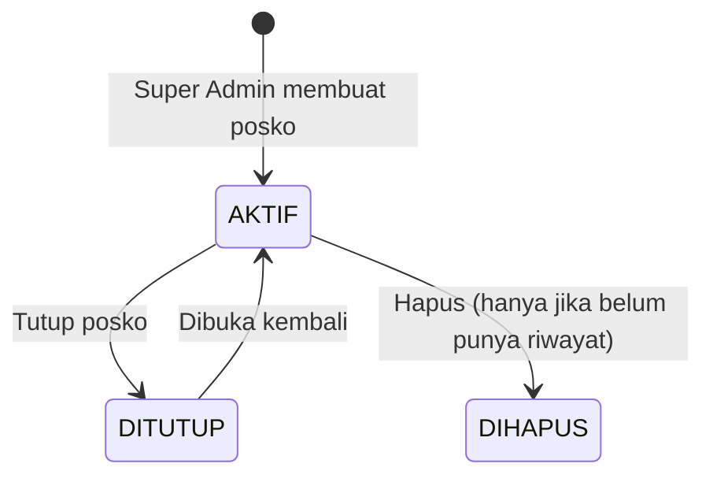

**Langkah:**
1. **Super Admin membuat posko**: nama, alamat, titik lokasi di peta, dan **kapasitas maksimal** (jumlah jiwa).
2. **Super Admin menunjuk Manager** (satu manager hanya memimpin satu posko).
3. **Super Admin menunjuk Ketua Divisi** untuk Logistik, Shelter, dan Pendataan. Ketua harus memang berperan Ketua Divisi di divisi dan posko yang sama.
4. Posko **AKTIF** muncul di halaman publik dan bisa menerima pengungsi.

**Aturan penting:**
- Kapasitas tidak boleh diturunkan di bawah jumlah penghuni saat ini.
- **Posko hanya bisa ditutup** jika penghuninya 0 dan tidak ada distribusi yang masih berjalan (dicadangkan atau dalam pengiriman).
- **Posko yang sudah punya riwayat tidak boleh dihapus**, cukup ditutup, supaya jejak data tetap utuh untuk audit.
- Posko yang ditutup tidak tampil di halaman publik dan tidak bisa menerima transaksi baru.

---

### 8.2 Pendataan Pengungsi (Check-in & Check-out) — Divisi Pendataan

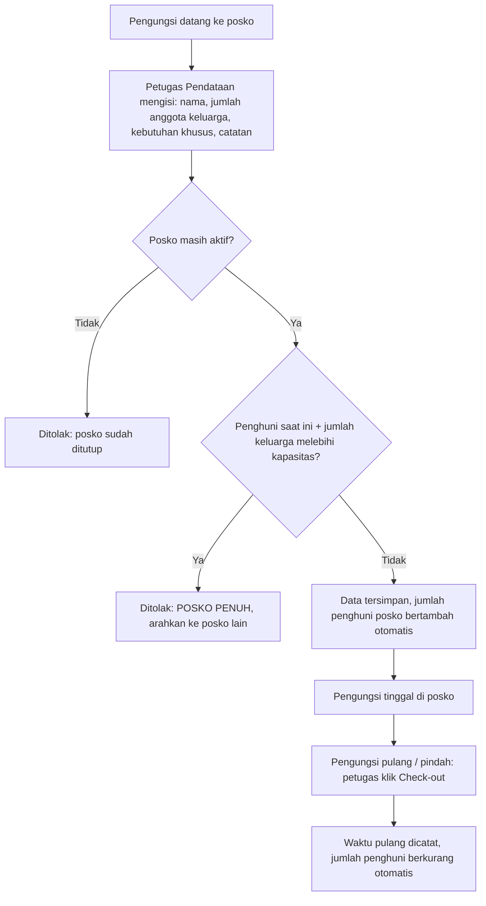

**Penjelasan sederhana:**
- Satu data pengungsi bisa mewakili **satu keluarga**. Kapasitas dihitung dari **jumlah jiwa**, bukan jumlah data.
- Pengecekan kapasitas dan penambahan penghuni dilakukan **dalam satu transaksi terkunci**. Jika dua petugas mendaftarkan bersamaan saat posko hampir penuh, sistem tidak akan membiarkan posko melebihi kapasitas.
- **Check-out ganda ditolak**: pengungsi yang sudah pulang tidak bisa di-check-out lagi, sehingga angka penghuni tidak bisa minus.
- Jumlah anggota keluarga **tidak bisa diedit langsung**. Jika berubah, lakukan check-out lalu daftar ulang, supaya angka okupansi selalu akurat.
- Penanda **kebutuhan khusus** (lansia, disabilitas, ibu hamil, dan sebagainya) membantu prioritas penanganan.

---

### 8.3 Manajemen Stok Logistik — Divisi Logistik

**Prinsip utama: angka stok tidak pernah diedit langsung.** Setiap perubahan stok harus lewat salah satu jenis pergerakan berikut, dan semuanya tercatat di buku besar (*ledger*).

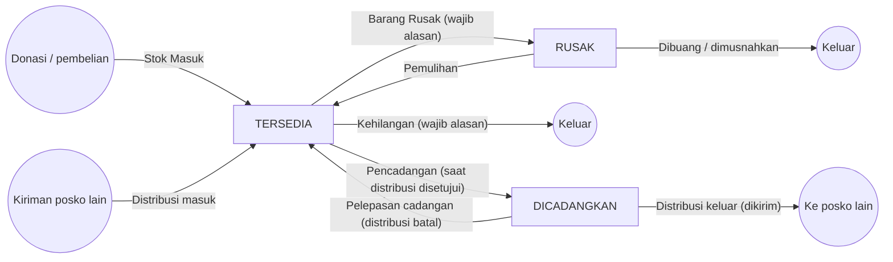

| Pergerakan | Arti | Aturan |
| --- | --- | --- |
| **Stok Masuk** | Barang datang (donasi/pembelian) | Jika item lama sedang berstatus rusak, sistem membuat **item pengganti** terpisah agar barang bagus tidak tercampur dengan yang rusak |
| **Barang Rusak** | Barang tersedia menjadi rusak | Alasan wajib, tidak boleh melebihi stok tersedia |
| **Kehilangan** | Barang hilang | Alasan wajib, tidak boleh melebihi stok tersedia |
| **Pemulihan** | Barang rusak ternyata masih layak | Tidak boleh melebihi jumlah rusak |
| **Dibuang** | Barang rusak dimusnahkan | Tidak boleh melebihi jumlah rusak |
| **Pencadangan / Pelepasan / Distribusi keluar / masuk** | Otomatis dari alur distribusi | Tidak bisa dibuat manual |

**Status stok dihitung otomatis oleh sistem:**

| Kondisi | Status |
| --- | --- |
| Ada barang rusak di item tersebut | **Rusak** |
| Stok tersedia (stok − dicadangkan) ≤ 0 | **Kritis** |
| Ada batas minimum dan stok tersedia ≤ batas minimum | **Menipis** |
| Selain itu | **Aman** |

Barang berstatus **Kritis** dan **Menipis** otomatis muncul di Dashboard (daftar tugas) dan Monitoring (peringatan).

---

### 8.4 Satuan Barang (Unit & Kemasan)

Masalah nyata di lapangan: barang dicatat dengan satuan yang berbeda-beda ("dus", "kardus", "kg", "gram", "liter", "botol"). Sistem menyeragamkannya:

**1. Satuan standar** (konversi pasti):

| Satuan | Disimpan sebagai |
| --- | --- |
| pcs, unit | apa adanya |
| kg | 1 kg = 1.000 g |
| l (liter) | 1 l = 1.000 ml |

**2. Satuan kemasan** (isinya berbeda tiap barang): dus, box, paket, karton, karung, sak, botol, galon, kaleng, bungkus, sachet, lembar, pasang, set.
- Selama isinya **belum diverifikasi** (status **"Perlu verifikasi"**), stok dihitung **per kemasan** (1 dus = 1 dus).
- Setelah **diverifikasi**, misalnya "1 dus = 24 pcs", status menjadi **"Terverifikasi"** dan stok bisa dikonversi ke satuan dasar.

**3. Penulisan alternatif dinormalkan otomatis**: kardus menjadi dus, kotak menjadi box, saset menjadi sachet, buah menjadi pcs, gram/gr menjadi g, liter/ltr menjadi l.

**Contoh kasus:**
- Posko A punya **Air Mineral 10 dus**, sudah diverifikasi **1 dus = 24 pcs**.
- Posko B meminta **48 pcs**. Sistem mengonversi menjadi **2 dus**.
- Posko B meminta **50 pcs**. **Ditolak**, karena 50 pcs bukan kelipatan isi dus (tidak bisa mengirim 2,08 dus).

Tujuannya agar **perhitungan antar posko tidak pernah salah satuan**.

---

### 8.5 Distribusi Antar Posko (Alur Paling Penting)

Ketika satu posko kekurangan barang, posko tersebut bisa **meminta dari posko lain** yang punya stok. Prosesnya melibatkan 3 pihak dengan **kontrol 4 tahap**.

#### Status distribusi

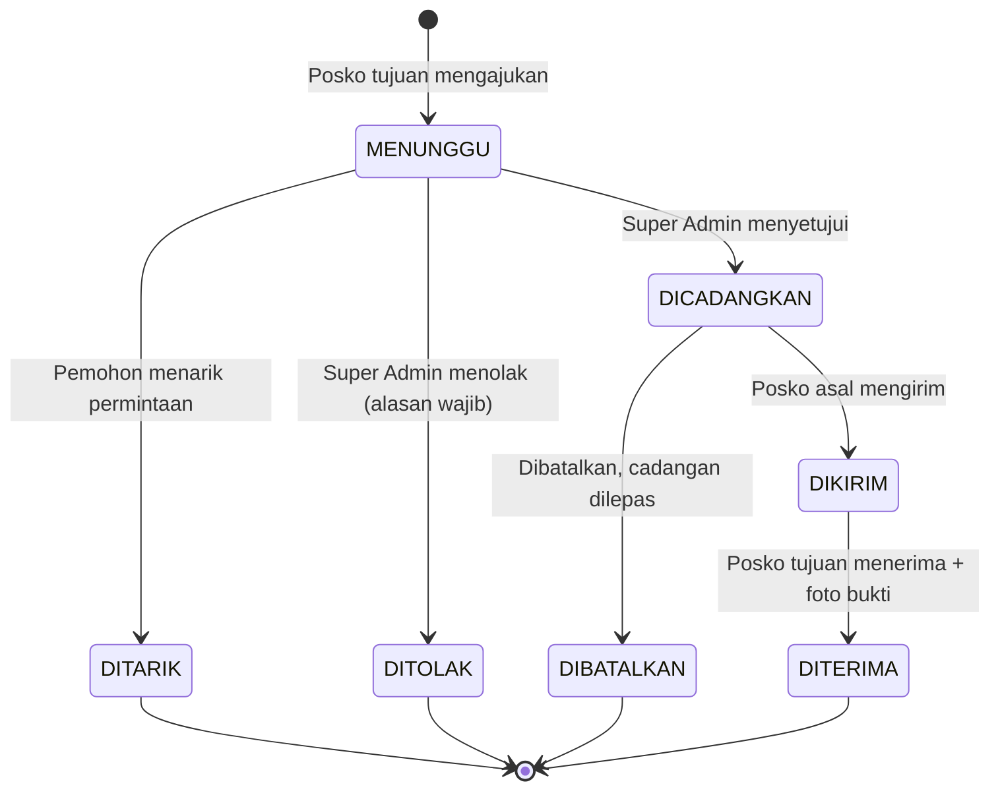

> Catatan: di sistem, "Ditarik" dan "Dibatalkan" sama-sama berstatus **CANCELLED**. Status "Disetujui" bersifat sesaat karena persetujuan dan pencadangan stok terjadi dalam satu langkah.

#### Siapa melakukan apa

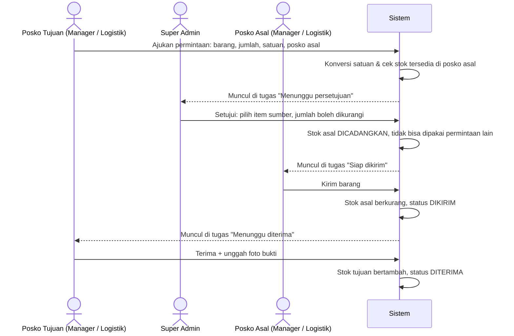

#### Penjelasan tiap tahap

| Tahap | Pelaku | Yang terjadi di sistem |
| --- | --- | --- |
| **1. Ajukan** | Manager / tim Logistik posko tujuan | Sistem mengecek posko asal benar-benar punya stok cukup. Status **Menunggu**. Selama masih menunggu, pemohon atau Manager posko tujuan boleh **menarik** permintaan. |
| **2. Setujui / Tolak** | **Hanya Super Admin** | **Setujui:** pilih item sumber (harus nama, satuan, dan definisi kemasan yang sama, serta tidak rusak); jumlah boleh ≤ yang diminta. Stok asal langsung **dicadangkan**. **Tolak:** alasan wajib diisi. |
| **3. Kirim** | Manager / tim Logistik posko asal (atau Super Admin) | Stok fisik posko asal berkurang, cadangan dilepas. Status **Dikirim**. Sebelum dikirim, posko asal atau Super Admin masih bisa **membatalkan** dan cadangan dikembalikan. |
| **4. Terima** | Manager / tim Logistik posko tujuan | **Foto bukti wajib** (JPG/PNG/WebP, maks. 3 MB, isi file diperiksa benar-benar gambar). Stok tujuan bertambah, masuk ke item yang sama jika sudah ada, atau dibuat item baru. Status **Diterima**. |

**Mengapa dibuat seperti ini?**
- **Persetujuan pusat (Super Admin)**: koordinator yang melihat kondisi semua posko memutuskan prioritas, sehingga bantuan tidak hanya mengalir ke posko yang paling cepat meminta.
- **Pencadangan stok**: barang yang sudah disetujui "dikunci", sehingga tidak bisa dijanjikan dua kali ke posko berbeda.
- **Foto bukti terima**: memastikan barang benar-benar sampai dan mencegah selisih.
- **Setiap tahap tercatat** di buku besar stok dan riwayat aktivitas, sehingga bisa ditelusuri siapa menyetujui, siapa mengirim, dan siapa menerima.

---

### 8.6 Shelter & Fasilitas — Divisi Shelter

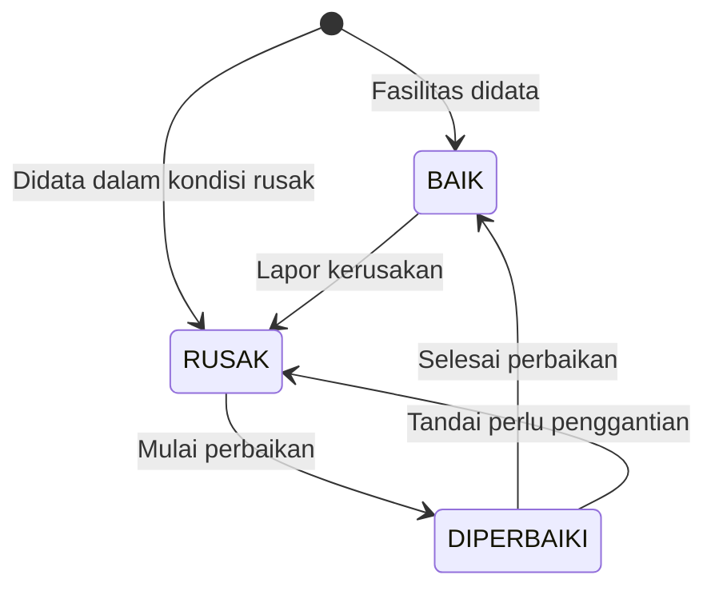

**Langkah:**
1. Petugas Shelter mendata fasilitas (misalnya "Toilet portabel 2", "Genset utama") dengan kondisi awal **Baik** atau **Rusak**.
2. Jika rusak, petugas **lapor kerusakan**, kemudian **mulai perbaikan**, kemudian **selesai perbaikan**.
3. Jika perbaikan gagal, fasilitas **ditandai perlu penggantian** (kembali berstatus rusak).

**Aturan:**
- Setiap perubahan status **wajib disertai catatan**, sehingga ada keterangan apa yang rusak dan apa yang dikerjakan.
- Status **tidak bisa diubah sembarangan** (misalnya langsung dari Rusak ke Baik tanpa perbaikan).
- Jika dua petugas mengubah fasilitas yang sama bersamaan, perubahan yang kedua ditolak agar tidak saling menimpa.

---

### 8.7 Dashboard Tugas, Monitoring & Peta

**Dashboard menampilkan "apa yang harus saya kerjakan sekarang"**, disesuaikan per peran:

| Tugas | Muncul untuk |
| --- | --- |
| Permintaan menunggu persetujuan | Super Admin |
| Distribusi siap dikirim (posko saya sebagai asal) | Manager / Logistik posko asal |
| Distribusi menunggu diterima (posko saya sebagai tujuan) | Manager / Logistik posko tujuan |
| Permintaan saya yang belum diproses | Manager / Logistik posko pemohon |
| Stok kritis & stok menipis | Yang punya akses logistik |
| Fasilitas rusak | Yang punya akses shelter |
| Posko hampir penuh (≥ 90%) | Yang punya akses pendataan |

**Monitoring** memberi peringatan dini (hanya untuk posko aktif):
- Posko dengan keterisian **≥ 90%**
- Barang dengan stok **kritis**
- Fasilitas **rusak**

**Peta Bencana (internal)** menampilkan warna per posko:

| Keterisian | Warna |
| --- | --- |
| ≥ 90% | Merah |
| ≥ 70% | Kuning |
| < 70% | Hijau |

---

### 8.8 Halaman Publik untuk Warga (`/public`, Tanpa Login)

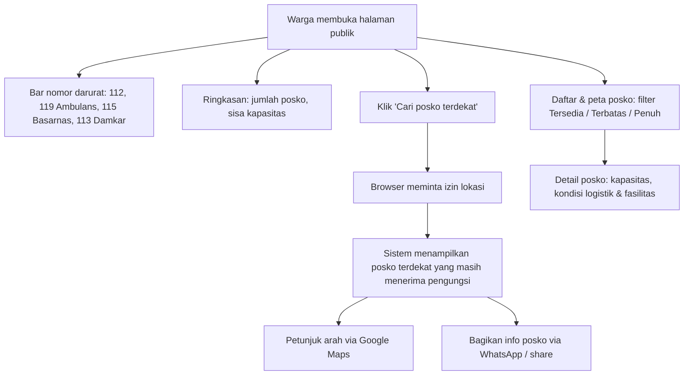

**Status ketersediaan untuk warga:**

| Keterisian | Status |
| --- | --- |
| < 80% | **Tersedia** |
| 80% – 99% | **Terbatas** |
| 100% | **Penuh** |

**Privasi:** halaman publik **hanya menampilkan angka agregat** (kapasitas, keterisian, kondisi umum). **Nama pengungsi, email, dan data pribadi tidak pernah ditampilkan.** Data diperbarui setiap ±30 detik.

---

### 8.9 Laporan

1. Pilih periode (default **30 hari terakhir**).
2. Sistem merangkum: posko, pengungsi, logistik, fasilitas, dan distribusi sesuai cakupan pengguna.
3. Ekspor:
   - **PDF**: lewat fitur cetak browser.
   - **Google Sheets**: tabel terformat, hanya untuk **Super Admin & Manager**.

**Privasi:** nama pengungsi di laporan hanya terlihat oleh Super Admin, Manager, dan divisi Pendataan.

---

### 8.10 Riwayat Aktivitas (Audit Trail)

Setiap aksi penting tercatat: siapa, melakukan apa, pada data apa, dan kapan. Contohnya penerimaan stok, verifikasi isi kemasan, penetapan manager, dan perbaikan fasilitas.

| Peran | Yang bisa dilihat |
| --- | --- |
| Super Admin | Semua aktivitas |
| Manager | Aktivitas seluruh tim di poskonya |
| Ketua Divisi | Aktivitas tim divisinya di posko tersebut |
| Petugas Lapangan | Aktivitasnya sendiri |

Ada **dua lapis pencatatan**:
- **Buku besar stok** (`InventoryMovement`): catatan resmi setiap pergerakan barang, ditulis dalam transaksi yang sama dengan perubahan stok, jadi tidak mungkin stok berubah tanpa tercatat.
- **Riwayat aktivitas** (`AuditLog`): catatan aktivitas pengguna secara umum.

---

### 8.11 Manajemen Pengguna & Login

**Login:**
- Email + password, atau **login dengan Google** (hanya untuk email yang sudah terdaftar dan terverifikasi; tidak ada pendaftaran bebas).
- Sesi berlaku 7 hari, dan sesi kedaluwarsa dibersihkan otomatis setiap hari pukul 03:00.
- Setelah 5 kali salah password dalam 15 menit, login untuk email tersebut diblokir sementara.

**Kelola akun:**
- **Super Admin**: membuat, mengubah, dan menghapus semua akun.
- **Manager**: mengubah data Ketua Divisi & Petugas di poskonya sendiri, tetapi **tidak bisa memindahkan mereka ke posko lain**.
- Tidak ada yang bisa menghapus akunnya sendiri.

---

## 9. Matriks Hak Akses

| Fitur | Super Admin | Manager | Ketua Divisi | Petugas Lapangan |
| --- | :---: | :---: | :---: | :---: |
| Buat / ubah / tutup / hapus posko | ✅ semua | 👁️ lihat posko sendiri | – | – |
| Tunjuk manager & ketua divisi | ✅ | – | – | – |
| Kelola akun | ✅ penuh | ✏️ tim posko sendiri | – | – |
| Logistik (stok & pergerakan) | ✅ semua posko | ✅ posko sendiri | ✅ jika divisi Logistik | ✅ jika divisi Logistik |
| Shelter & fasilitas | ✅ semua posko | ✅ posko sendiri | ✅ jika divisi Shelter | ✅ jika divisi Shelter |
| Pengungsi | ✅ semua posko | ✅ posko sendiri | ✅ jika divisi Pendataan | ✅ jika divisi Pendataan |
| Distribusi: ajukan / tarik | ✅ | ✅ | ✅ Logistik | ✅ Logistik |
| Distribusi: **setujui / tolak** | ✅ **satu-satunya** | – | – | – |
| Distribusi: kirim / batalkan | ✅ | ✅ posko asal | ✅ Logistik posko asal | ✅ Logistik posko asal |
| Distribusi: terima | ✅ | ✅ posko tujuan | ✅ Logistik posko tujuan | ✅ Logistik posko tujuan |
| Dashboard, monitoring, peta, laporan | ✅ semua | ✅ posko sendiri | ✅ posko sendiri | ✅ posko sendiri |
| Ekspor Google Sheets | ✅ | ✅ | – | – |
| Riwayat aktivitas | Semua | Posko | Divisi di posko | Milik sendiri |
| Halaman publik | Semua orang, tanpa login |  |  |  |

---

## 10. Keamanan & Integritas Data

### Keamanan akses
- **Password di-hash** (bcrypt), tidak pernah disimpan dalam bentuk asli.
- **Sesi login** disimpan sebagai hash di database dan di cookie `httpOnly` (tidak bisa dibaca JavaScript), sehingga bisa dicabut kapan saja.
- **Pembatasan percobaan login** (5 kali gagal per 15 menit). Waktu respons dibuat sama untuk email terdaftar maupun tidak, agar penyerang tidak bisa menebak email mana yang terdaftar.
- **Pengecekan hak akses di setiap API**, bukan hanya menyembunyikan tombol di tampilan.
- **Endpoint cron dilindungi secret**. Tanpa secret, endpoint ditolak di production.
- **Unggahan foto bukti diperiksa isinya**, bukan sekadar ekstensi file.

### Integritas data (angka tidak bisa "kacau")
- **Transaksi terkunci (Serializable)** untuk semua operasi stok dan okupansi. Jika dua petugas menekan tombol bersamaan, hasilnya tetap benar, dan sistem otomatis mengulang jika terjadi bentrok.
- **Aturan dikunci di level database** sebagai lapisan terakhir:
  - penghuni posko selalu antara 0 dan kapasitas;
  - stok, cadangan, dan barang rusak tidak pernah negatif;
  - cadangan tidak pernah melebihi stok.
- **Buku besar stok**: setiap angka stok bisa ditelusuri asal-usulnya.
- **Posko tidak dihapus jika punya riwayat**, cukup ditutup.

### Privasi
- Halaman publik **hanya angka agregat**.
- Nama pengungsi hanya untuk peran yang berwenang.

---

## 11. Kualitas & Pengujian

| Jenis | Jumlah | Yang diuji |
| --- | --- | --- |
| **Unit test** | 10 file, **150 test** | Konversi satuan, validasi input, hak akses, perhitungan dashboard, logika halaman publik, login Google, penanganan error |
| **Integration test** | 5 file, **49 test** | Dijalankan ke **database PostgreSQL sungguhan** (terpisah dari production): alur stok lengkap, alur distribusi dari ajukan sampai terima, uji **dua permintaan bersamaan** (hanya satu yang boleh berhasil jika stok tidak cukup), dan check-out pengungsi |
| **Pemeriksaan otomatis** | – | Type-check TypeScript, lint, build production |

**Proses rilis:**
1. Kode di-push ke repository.
2. Vercel otomatis build dan deploy.
3. Perubahan struktur database (migrasi) dijalankan otomatis **hanya saat deploy production**.
4. Test integrasi **tidak pernah** menyentuh database production; ada pengaman yang menolak jika alamat database sama.

---

## 12. Skenario Demo (±4 Menit)

> Siapkan beberapa tab browser dengan akun berbeda sebelum presentasi agar tidak perlu login berulang.

1. **Halaman publik** (tanpa login)
   - Tunjukkan nomor darurat, peta, dan status Tersedia/Terbatas/Penuh.
   - Klik **"Cari posko terdekat"**, lalu tunjukkan petunjuk arah dan tombol bagikan.
2. **Login sebagai Petugas Pendataan**
   - Daftarkan satu keluarga (misalnya 4 jiwa), lalu tunjukkan angka penghuni bertambah.
   - (Opsional) Coba daftarkan melebihi kapasitas untuk menunjukkan penolakan **"Posko penuh"**.
3. **Login sebagai Logistik posko yang kekurangan**
   - Tunjukkan barang berstatus **Kritis/Menipis**.
   - Buat **permintaan distribusi** ke posko lain.
4. **Login sebagai Super Admin**
   - Buka Dashboard dan tunjukkan tugas **"Menunggu persetujuan"**.
   - **Setujui** dan tunjukkan stok posko asal kini **dicadangkan**.
5. **Login sebagai Logistik posko asal**
   - Tugas **"Siap dikirim"**, lalu klik **Kirim**.
6. **Kembali ke posko tujuan**
   - Tugas **"Menunggu diterima"**, lalu **Terima + unggah foto**, dan tunjukkan stok bertambah.
7. **Riwayat item & Riwayat Aktivitas**
   - Tunjukkan jejak lengkap: siapa mengajukan, menyetujui, mengirim, dan menerima.
8. **Laporan**
   - Generate laporan 30 hari, lalu (opsional) kirim ke Google Sheets.

---

## 13. Keterbatasan Saat Ini & Rencana Pengembangan

### Keterbatasan (jujur disampaikan)
| Keterbatasan | Dampak | Rencana |
| --- | --- | --- |
| Belum bisa offline | Posko dengan sinyal buruk kesulitan input | Mode offline (PWA) dengan sinkronisasi otomatis |
| Belum ada notifikasi | Petugas harus membuka dashboard untuk tahu ada tugas | Notifikasi WhatsApp / push |
| Pembatasan login per server | Pada beban sangat tinggi, batas login bisa tidak seragam antar server | Pindah ke penyimpanan bersama (Redis/KV) |
| Daftar distribusi & laporan belum dipaginasi | Lambat jika datanya sangat banyak | Paginasi & filter tambahan |
| Foto bukti disimpan di database | Database cepat membesar | Pindah ke object storage (misalnya Vercel Blob) |

### Ide pengembangan lanjutan
- **Estimasi kebutuhan logistik otomatis** berdasarkan jumlah pengungsi (misalnya kebutuhan beras per jiwa per hari).
- **QR code / kartu pengungsi** untuk check-in & check-out lebih cepat.
- **Pencarian keluarga** (reunifikasi) dengan kontrol privasi ketat.
- **Integrasi data peringatan dini** (misalnya BMKG) di dashboard.
- **Laporan donatur**: transparansi penggunaan bantuan.

---

## 14. Antisipasi Pertanyaan (Q&A)

**T: Kenapa stok tidak bisa langsung diedit angkanya?**
J: Supaya setiap perubahan punya alasan dan pelaku yang tercatat. Jika angka bisa diedit bebas, selisih stok tidak bisa ditelusuri. Dengan buku besar, kita selalu tahu kenapa stok berkurang: rusak, hilang, atau dikirim.

**T: Bagaimana kalau dua petugas menginput bersamaan?**
J: Operasi stok dan okupansi berjalan dalam transaksi terkunci. Sistem menjamin hasilnya sama seperti jika dikerjakan bergantian. Ini sudah diuji: dua permintaan bersamaan atas stok yang hanya cukup untuk satu, maka hanya satu yang berhasil.

**T: Kenapa persetujuan distribusi hanya oleh Super Admin, bukan oleh posko asal?**
J: Super Admin melihat kondisi semua posko, sehingga bisa memprioritaskan posko yang paling membutuhkan. Posko asal tetap berperan sebagai pelaksana pengiriman.

**T: Apakah data pengungsi aman?**
J: Halaman publik hanya menampilkan angka. Nama pengungsi hanya bisa dilihat oleh Super Admin, Manager, dan divisi Pendataan. Semua akses tercatat.

**T: Kalau bencana selesai, posko dihapus?**
J: Tidak, posko **ditutup**. Riwayatnya tetap tersimpan untuk laporan dan audit. Penutupan hanya bisa dilakukan jika posko sudah kosong dan tidak ada distribusi yang berjalan.

**T: Bagaimana jika barang tercatat dengan satuan berbeda, misalnya dus vs pcs?**
J: Sistem menormalkan satuan. Satuan kemasan harus diverifikasi isinya (misalnya 1 dus = 24 pcs) sebelum bisa dikonversi. Permintaan yang tidak pas kelipatannya ditolak agar tidak terjadi pengiriman "setengah dus".

**T: Bisa dipakai untuk wilayah lain / skala lebih besar?**
J: Bisa. Posko, tim, dan kapasitas dikonfigurasi lewat aplikasi, tidak ditulis di kode. Database PostgreSQL sudah diberi indeks untuk query utama, dan hosting serverless menyesuaikan beban.

---

## 15. Lampiran: Kamus Status

| Kelompok | Kode sistem | Label di aplikasi |
| --- | --- | --- |
| Peran | SUPER_ADMIN / MANAGER / DIVISION_HEAD / FIELD_OFFICER | Super Admin / Manager Posko / Ketua Divisi / Petugas Lapangan |
| Divisi | LOGISTICS / SHELTER / DATA_REGISTRATION | Logistik / Shelter & Fasilitas / Pendataan Pengungsi |
| Posko | ACTIVE / CLOSED | Aktif / Ditutup |
| Stok | SUFFICIENT / LOW / CRITICAL / SPOILED_OR_DAMAGED | Aman / Menipis / Kritis / Rusak |
| Fasilitas | GOOD / DAMAGED / REPAIRING | Baik / Rusak / Dalam Perbaikan |
| Distribusi | PENDING / APPROVED / RESERVED / REJECTED / SHIPPED / RECEIVED / CANCELLED | Menunggu / Disetujui / Dicadangkan / Ditolak / Dalam Pengiriman / Diterima / Dibatalkan |
| Pergerakan stok | RECEIPT / DAMAGE / LOSS / RESTORE / DISPOSE | Stok Masuk / Barang Rusak / Kehilangan / Pemulihan / Dibuang |
| Pergerakan otomatis | RESERVATION / RESERVATION_RELEASE / DISTRIBUTION_OUT / DISTRIBUTION_IN | Pencadangan / Pelepasan Cadangan / Distribusi Keluar / Distribusi Masuk |
| Satuan kemasan | CONFIGURED / NEEDS_REVIEW | Terverifikasi / Perlu verifikasi |
| Ketersediaan publik | AVAILABLE / LIMITED / FULL | Tersedia / Terbatas / Penuh |

---

## Penutup

**Siaga Bencana** mengubah pengelolaan posko dari catatan manual yang tersebar menjadi sistem yang:
- **Real-time**: kapasitas dan stok selalu terbaru.
- **Terkendali**: setiap orang bekerja sesuai perannya.
- **Dapat diaudit**: setiap barang dan setiap aksi punya jejak.
- **Bermanfaat bagi warga**: informasi posko terdekat tersedia tanpa login.

> *"Bantuan yang tepat, ke posko yang tepat, dengan jejak yang jelas."*

**Terima kasih.**
